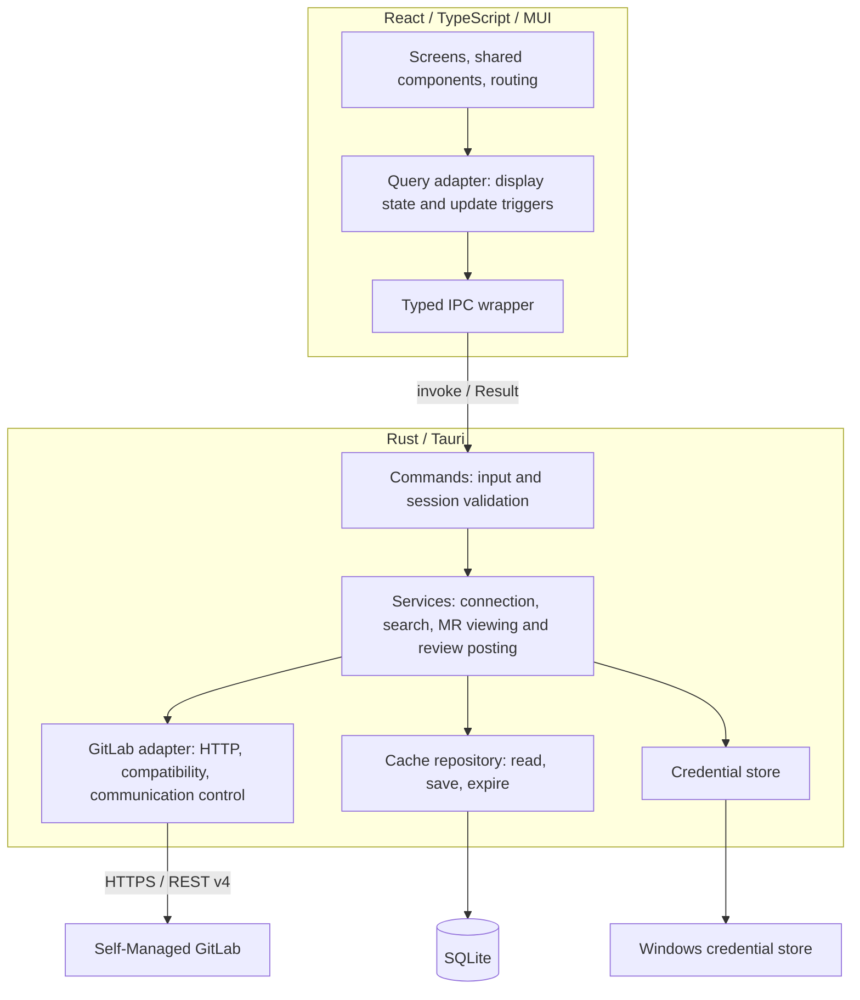

# GitLab Desktop architecture

Designed on 2026-09-30. On 2026-10-04 the first client was implemented for connection, search, cache, review and distribution. This document includes design goals. It does not record that every performance goal or environment compatibility was reached. For the current scope, see the README and the verification records. Compatibility with a real Self-Managed instance has not been checked.

User requirements: make merge request (MR) lists, diffs and review easy to use on GitLab.com and Self-Managed GitLab, and search projects and past MRs. There is no company instance now, so real communication is verified against GitLab.com. Reduce the waiting time of the web version, and keep the UI consistent as AI-written code accumulates.

Fixed conditions: MR search covers the title and description. MRs can also be found by number. The app connects from the company network. Normal connection and communication do not use glab; Rust connects to the GitLab API directly. Only when the user explicitly chooses "Connect with glab credentials" on the connection screen does Rust import the saved credential that matches the target URL, once. Fetched data is cached persistently. The initial goal includes normal review operations, and the first improvements target loading waits and operation lag when there are many MRs or discussions.

Besides the startup base, the app implements PAT connection, import of a glab-saved PAT or OAuth access token by explicit action, project and MR search, diff and discussion fetching, the normal review API, the Windows credential store, the SQLite cache, and a signed update path. Selection of an additional CA, the app's own OAuth login and automatic refresh, resident sync, and p95 performance verification under load come later. Verification uses the public GitLab.com API and HTTP fixtures, and is kept separate from authenticated live posting and verification in the company environment.

## 1. Target experience and scope

The main flow is fixed as "find a project → find a current or past MR → read the content, diff and discussions → review if needed". The top screen changes from environment diagnostics to "review requests, recently opened MRs and pinned projects". Environment diagnostics move to the settings screen.

The first practical version, v0.1, completes project search, MR search including past MRs, MRs for me to review, viewing MR details, diffs and discussions, and normal review operations. A read-only version is an intermediate checkpoint, not the finish. Both search and posting are completion conditions for v0.1.

| In the first version | Later stages | Out of scope for now |
| --- | --- | --- |
| Self-Managed connection, project search, MR search across all states | Issues, pipelines, limited log display | GitLab admin screens, CI configuration editing, member management |
| Viewing MR overview, diffs and discussions with a persistent cache | Diff between a linked local clone and the latest MR (read-only) | Repository clone/push, fetch, branch operations, IDE |
| Comments, line comments, replies, editing and deleting own comments, resolve/reopen | Local full-text search, as needed and measured | A local copy of all of GitLab, an index of all code |
| Drafts and publishing, approve/revoke approval, request changes, re-request review, merge, auto-merge, rebase, close/reopen, changing title, Draft, labels and milestone, recently opened items, pinning, saved search conditions | Using multiple connections at the same time | Automatic sending of offline writes |

Review operations are offered within GitLab's permissions and feature support. An operation that cannot be completed through the API, such as an organization's re-authentication, is opened in GitLab with the reason shown. An unsupported operation is never treated as successful.

The first UI has one window and one active connection. Data keys include the instance and the user from the start. Even if switching between multiple connections is added later, the structure keeps work and home data from mixing.

## 2. Architecture

The inside of a single Tauri app is divided into modules by feature. There is no separate resident server and no microservice. Rust stays in one crate for now, and only the boundaries to external systems can be replaced in tests.

The normal connection path does not depend on installing or running glab, on its configuration files, or on its credentials. As the one exception, only when the user explicitly chooses "Connect with glab credentials" does Rust read the saved credential bound to the target URL's host. HTTP, authentication and error handling are concentrated in the Rust GitLab adapter, and after the import nothing delegates HTTP or refresh to glab.



| Owner | Responsibility | Not its responsibility |
| --- | --- | --- |
| View / MUI | Display, input, selection, focus, layout | Interpreting API responses, SQL, credential management |
| Query adapter | Loading/reloading/failure state, in-memory display data, updates while a screen is shown | HTTP retries, persistent cache, tokens |
| IPC Commands | Input validation, matching session and request IDs, DTO conversion | Building GitLab URLs, complex business logic |
| Application services | Normalizing search conditions, the steps of connecting, viewing and posting, updating the cache | Depending on MUI or the Tauri Window |
| GitLab adapter | HTTP, response conversion, paging, feature differences, retries, size limits | UI state, direct DB access |
| Repositories / OS adapters | SQLite, the credential store, launching the external browser | Branching per screen |

API response types, in-app types and IPC types are kept separate. A huge GitLab type with every field copied is not passed to the UI. Multi-level abstract classes and generic repositories are not added for small fetch operations.

## 3. Technology choices and when to adopt them

| Technology | Decision | Reason and constraints |
| --- | --- | --- |
| Tauri 2 / Rust / React / TypeScript / MUI | Keep | Uses the existing base. WebView rendering remains |
| Local routes | v0.1 uses browser hash routes | Keeps the search conditions and the return from a list to a detail. Consider a router library when routes grow. No SSR |
| TanStack Query | Adopt in v0.1 | IPC calls become the queryFn, which reduces hand-written async state management |
| reqwest + Tokio | Adopt in v0.1 | Concentrates HTTP in Rust. TLS and proxy are checked together in the target environment |
| rusqlite + bundled SQLite | When the cache is implemented | Personal local storage. A dedicated DB worker isolates synchronous work |
| Windows credential store | When authentication is implemented | Through a thin Rust adapter. Check and pin the Windows support and maintenance of keyring and similar crates at implementation time |
| ts-rs | When IPC types grow | Generates TypeScript types from Rust DTOs. Command names and wrappers are also checked by contract tests |
| SQLite FTS5 | Later candidate | After checking Japanese search quality and the scope of stored data. v0.1 search uses the server |
| Redux / Zustand, GraphQL, Monaco, SQLx, resident sync | Not added to the first version | The need is not confirmed. A whole IDE is not bundled just to show diffs |

TanStack Query has default refetching and retries, so they are set explicitly for this app. [Official defaults](https://tanstack.com/query/latest/docs/framework/react/guides/important-defaults). The design considered [ts-rs](https://docs.rs/ts-rs/latest/ts_rs/) for type generation and [rusqlite](https://docs.rs/rusqlite/latest/rusqlite/) for the DB layer. No new dependency has been added yet.

## 4. Screens and navigation

| Screen | Main content | Top-priority action |
| --- | --- | --- |
| Connection settings | Base URL, credential registration, connection result, local storage settings | Verify the connection |
| Review | Open MRs where I am a reviewer, switch between created and assigned, recently opened items | Open an MR |
| Projects | Pinned and recent projects, server search, namespace | Choose a project |
| MR search | Title/description, state, author, period, project/group | Narrow the conditions and open |
| MR detail | Overview, changes, discussions, drafts, approval state | Check the diff and review |
| Settings | Instance, credential update, theme, cache, diagnostics | Change settings |

The fixed sidebar is "Review / Projects / MR search / Settings". The top bar holds the instance and current project, the search entry and the sync state. Separate screens for issues and pipelines are added later. A feature that cannot be used is not shown permanently in the first version's navigation.

The MR detail opens with the selection state of the list kept. The basic layout is two areas, file list and diff. Discussions go in a tab or a collapsible panel, and are not made a permanent third column that narrows the others. At about 960 CSS px the sidebar collapses and file selection moves to a Drawer. Only wide screens show the list and detail side by side. The physical window size and the CSS size are not confused, and the layout is checked at Windows display scales of 100/125/150%.

Example URLs are `#/c/:connectionId/review`, `#/c/:connectionId/projects`, `#/c/:connectionId/search/mrs?...` and `#/c/:connectionId/p/:projectId/mr/:iid?tab=changes`. The user ID is resolved from the active session. URLs do not contain credentials. The original GitLab URL is used for sharing.

Search conditions, selection and page position are restored by going back. Changing a filter returns to the top of the results. A value being typed is local state, an applied condition is in the route, server content is in Query, and settings such as the theme are in settings.

## 5. Project and past MR search

v0.1 uses the search parameters of the normal Projects and Merge requests APIs. It does not assume the paid features of Self-Managed or an advanced search index prepared by an administrator.

| Operation | API approach | Scope the UI states |
| --- | --- | --- |
| Project search | `GET /projects?search=...`. Joined projects use `membership=true`; viewable projects drop this restriction | Joined or viewable, whether archived projects are included |
| Past MRs in a project | `GET /projects/:id/merge_requests` with the search term and state. `!123` narrows by `iids[]=123` only; `123` puts the MR with that number first, followed by title and description matches | The selected project, all states by default |
| Branches of a project | `GET /projects/:id/repository/branches?sort=updated_desc` with a name search term. GitLab versions without sorting use name order | The selected project |
| Code of a project | A folder uses `GET /projects/:id/repository/tree` with `path` and `ref` (the default branch when omitted), 100 entries at a time. A file reads `GET /projects/:id/repository/blobs/:sha/raw` with the blob ID returned by the list, and, as with the file body of an MR, shows only text up to 1 MiB, read as described in "Text encodings" below. The content for a blob ID never changes, because it is read by blob ID. A 404 from `tree` is also returned for an empty repository or a deleted branch or folder, so the account cache is not deleted (the screen does not show stored content for a 404) | The selected project and branch, read-only |
| Past MRs across the instance | `GET /merge_requests?scope=all&state=all&search=...`. Outside a project, an MR number is found with `GET /search?scope=merge_requests&search=%23123` (`/groups/:id/search` inside a group); `!123` shows only that match, and `123` puts that match first, followed by title and description matches | MRs viewable on the current instance |
| Search within a group | Uses the corresponding group MR list, published after support is confirmed | The selected group, handling of subgroups |
| Review requests | Specify the reviewer condition and opened; confirm server support | Review requests to me |
| Direct MR specification | Interprets `!123` in the selected project, or a GitLab MR URL | Fix the instance and project, then fetch the detail |

`membership` in Projects restricts the results to joined projects. The normal target of MR search is the title and description, not a full-text search of comments or diff code. `iids[]` is accepted only by a project's MR list, and the group and instance-wide lists ignore it. So an MR number outside a project is found by using the fact that GitLab search treats `#123` as an MR number. The search API accepts no conditions other than the state, so it reads 100 results at a time, and Rust applies assignee, reviewer, author, label, branch and updated-date conditions. A number match that is not in these 100 is not shown. [Search API](https://docs.gitlab.com/api/search/). `scope` is not omitted, so the search is not unintentionally limited to MRs I created. [Projects API](https://docs.gitlab.com/api/projects/), [Merge requests API](https://docs.gitlab.com/api/merge_requests/).

The initial filters are state, author, updated period and project. Reviewer, label and branch are added in turn. Filters are shown as chips and an input field, and the first version does not create its own query language. MR search defaults to "all states", and only the Review screen defaults to "open".

Ctrl+K is the entry for moving to pinned or recent items and to the search screen. Server search runs on Enter. If automatic search of suggestions is added, a debounce of about 300 ms, suppression during IME composition and discarding of stale responses are required. Short Japanese searches are not rejected across the board.

The starting point is 30 items per page, using the next-page information that was fetched. The UI shows text such as "30 loaded, more available", and does not guess a total that includes pages not fetched. Multiple pages are deduplicated by ID, and a change of order caused by updates is resolved by reloading the list. The N+1 approach of listing all projects and searching each one for MRs is not adopted.

Past MRs can be found by server search even when they are not in the cache. Offline, the UI states that it switched to "the stored range", and does not present local results alone as the result of a full search. v0.1 stops at redisplaying earlier search results and recently opened MRs, and local full-text search with arbitrary words comes later.

## 6. Responsibilities for loading, updating and caching

GitLab is the source of truth, SQLite holds the fetched data made persistent, and TanStack Query holds the temporary data for display. In the first version, update timers exist only in the Query adapter. Rust handles de-duplication of requests, retries and saving, and does not run its own periodic polling.

Representative flow:

1. Fix the query key of the screen. It includes the instance, user, resource, conditions, page and the version being shown.
2. Only the first time, get the SQLite snapshot with a Rust CacheOnly read. This does not communicate.
3. The Query adapter checks the session generation, reflects the data in memory, and sets the fetch time as the equivalent of `dataUpdatedAt`.
4. If the data is not fetched or has expired, run a NetworkOnly update command. If there is stored content, keep showing it and show "Updating…".
5. Rust validates the session, then fetches from GitLab, converts to DTOs, saves to SQLite and returns the result.
6. Only results with a valid generation, query key and request ID are reflected in the UI. When an update fails, the old content is shown together with the reason for the failure.

The common adapter guarantees the order of starting communication after the cache read. A cache result that arrives late does not overwrite a newer network result. Query `retry=false` is set, and the default refetch on browser focus is disabled; the adapter handles Tauri's show/restore notification. Discarding an IPC Promise alone cannot cancel Rust communication, so a cancel command that matches the request ID is provided. A shared identical request is canceled only when the last user leaves.

| Data | Initial freshness (to be measured) | Automatic update |
| --- | --- | --- |
| Project list | 5 minutes | On display and manual update |
| Project/MR search results | 60 seconds | On applying conditions, revisiting and manual update. No continuous polling on the search screen |
| Open MR list/overview | 30 seconds | Every 60 seconds only while shown, on restore if stale |
| Merged/closed MR overview | 5 minutes | On display and manual update. Discussions and others can change later |
| Discussions | 30 seconds | Only while shown: latest page every 60 seconds, loaded older pages every 5 minutes; on tab display and manual update |
| Diff of a given commit | Reused if the version is the same | Switches to another key when the head changes |
| Pipeline | Start from 15 seconds while running | Only while the MR's pipeline tab is shown. Updates only running pipelines, jobs and job logs, and stops after they finish |

While the app is hidden, the first version stops periodic updates. A target whose fetch failed does not stop periodic updates either; its interval drops to 5 minutes (except for lost permission or deletion). Unsent text or an in-progress write does not stop periodic updates. On restore, only stale displayed targets are updated, and all screens are not refetched at the same time. Monitoring and notification after the app is closed are out of scope for the first version. When resident sync is introduced in the future, the responsibility for updates moves to Rust and the UI timers are removed.

Offline use is mostly read-only. MRs and diffs that were not fetched are shown as not openable. Writes are not queued or resent automatically.

## 7. IPC contract and communication control

Commands are split by purpose, such as `search_projects`, `search_merge_requests`, `get_merge_request`, `get_mr_diff_page` and `get_mr_discussions`. Each read command states CacheOnly or NetworkOnly. `request(url, headers)` and arbitrary SQL execution are not exposed.

```typescript
// Example of the contract. At implementation time it is generated from Rust.
type RequestContext = {
  sessionId: string;
  requestId: string;
};
type Snapshot<T> = {
  data: T;
  fetchedAt: string;        // UTC, the time last confirmed on the server
  source: 'cache' | 'network';
  revision: string;        // identifies this stored result
  nextPageToken: string | null;
  completeness: 'page' | 'complete' | 'truncated';
};
type ErrorCode =
  | 'AUTH_REQUIRED' | 'FORBIDDEN' | 'NOT_FOUND' | 'RATE_LIMITED'
  | 'NETWORK' | 'TLS' | 'TIMEOUT' | 'UNSUPPORTED' | 'TOO_LARGE'
  | 'CANCELLED' | 'INVALID_INPUT' | 'STORAGE' | 'UNKNOWN_OUTCOME';
```

A cache that is not fetched returns a miss, distinct from an error. The error DTO has a code, a user-facing message, retryAfterMs and a request ID for support, and does not include raw HTTP bodies, credentials or detailed local paths. GitLab IDs are validated as integers on the Rust side and sent as decimal strings over IPC to avoid JS big-number rounding. Times are stored in UTC and shown in local time by the UI.

A page token is an opaque value bound to the search conditions and the connection session. The app does not trust a value returned by the UI to access an arbitrary URL. GitLab's next URL is also checked to be within the registered origin, base path and API path.

One HTTP client is reused per instance. The initial values are 8 concurrent requests (opening an MR's changes reads about seven resources at once, and each waits on GitLab for about half a second), and 1 per identical key. The request queue also has a limit, and old searches and prefetches are canceled first. For normal JSON the starting points are 5 seconds to connect, 20 seconds overall, and 5 MiB after decompression; large responses get a separate limit.

A transient communication failure or some 5xx on a GET is retried up to 2 times with backoff including jitter. The wait deadline for 429 is shared per instance in Rust and is not bypassed by a manual update in the UI. A long Retry-After does not keep a timer for a long time; it returns the time when a retry is possible. 401/403 are not retried. A non-idempotent post is not resent automatically even when the communication result is unknown.

The retry count is verified including the behavior inside the HTTP library. Query, application and HTTP layers must not each retry and multiply the number of requests.

## 8. Self-Managed connection and authentication

The instance saves not only the origin but also a base path such as `https://git.example.local/gitlab/`. The URL's trailing part and default port are normalized, and userinfo, query and fragment are rejected. An IP or internal host is accepted for Self-Managed use, but communication is limited to connections the user registered.

The design assumes a direct connection from the company network. A PAT is the first candidate. For read-only verification a classic PAT with `read_api` works, but a classic PAT that also posts reviews needs `api`. `write_repository` is not a substitute for write permission to the API. When fine-grained tokens are available, they are limited to the needed operations. Availability is checked with the server version and organization settings, and the token type is not fixed. [Access token scopes](https://docs.gitlab.com/security/tokens/access_token_scopes/).

The PAT is received once in a dedicated form and exists in UI memory only while being typed. It is passed to Rust over IPC, the instance's own user information is fetched to fix the user ID, and the PAT is saved in the OS credential store. The input value is discarded on success or failure, and no read API returns the secret to the UI. If the credential store is unavailable, the app does not silently fall back to a plain-text file.

Import of a glab-saved credential is allowed only when the user explicitly chose "Connect with glab credentials". From the connection URL, Rust derives the normalized HTTPS `authority` and subpath, and handles only entries where the key of `hosts[authority]`, `api_host`, HTTPS and the subpath all match. The targets are PATs and OAuth access tokens, and it verifies that the OAuth expiry parses as RFC3339 and is in the future. Refresh tokens are not imported, and the app's own OAuth login and automatic refresh are not performed.

The path that reads from the keyring is used only when `use_keyring=true` is set explicitly. Rust creates a temporary configuration for the target host only, without the token, and runs the fixed `glab config get token --host` command. It does not rewrite the existing global configuration, and it does not start `glab login`, `glab auth login` or `glab auth refresh`. Only after the connection check and the `/user` check succeed is the obtained access token copied to the Windows credential store, and after that all GitLab API communication goes directly from Rust's HTTP adapter. Manual PAT connection continues separately from this import path.

The connection flow is "URL and network settings → TLS/HTTP connection → authentication and identity check → server information and required API check → show what will be saved → start using". If a corporate SSO login page is returned, the app does not mislead the user with a JSON error or a prompt to re-enter the password. In an environment where PATs are prohibited, OAuth PKCE and app registration are designed separately. No client secret is embedded in the app.

For the proxy, the use of OS and environment settings is verified, and an explicit per-connection setting is added if needed. Proxy authentication values are also kept in the credential store. For an internal CA, support for the OS trust store comes first, and when it is not enough, an additional CA that the user selected is used per connection. PAC, NTLM and mTLS are not assumed to work and are checked in the target environment. A workaround that disables certificate verification is not adopted. [reqwest settings API](https://docs.rs/reqwest/latest/reqwest/struct.ClientBuilder.html).

Automatic redirects are avoided in full, and the authentication header is not forwarded to another origin. The GitLab token is not reused for external images or attachments in the body. For images in Markdown, Rust fetches, with authentication, only images of the instance and returns them as `data:` URLs (PNG/JPEG/GIF/WebP/SVG, up to 3 MB; SVG is shown in ``, so scripts and external references do not run). The targets are the `uploads/` paths in comments and MR descriptions, and relative-path images in Markdown in the repository (README, the Code tab, MR diffs). A relative path is resolved from the file's folder (a path starting with `/` from the repository root), and read from `api/v4/projects/<numeric ID>/repository/files/<encoded path>/raw?ref=<ref>` at the commit or branch of the version being shown. Rust allows only URLs of this form and does not let them reach other APIs. For a response that does not return a type, the image format is determined from the first bytes of the file (for SVG, the first `<svg` element). Images on external hosts are not shown. Relative links in Markdown in the repository become the GitLab file URL of the version being shown (`<project>/-/blob/<ref>/<path>`), and the in-app URL handling opens them in the Code tab. External URLs have their protocol validated and are handed to the OS browser. URLs with credentials are not accepted.

Changing the connection or logging out updates the session generation, cancels old requests, discards Query, and invalidates in-progress DB writes. It guarantees that a response arriving late after logout does not recreate the cache. When 401 requires re-authentication, the display of private data stops. A resource that may have lost permission, through 403/404, does not automatically fall back to stored data. Offline, the app does not guarantee that it can verify the current server permissions.

## 9. Data storage and compatibility

Data is stored in the app's directory under the user profile, not inside a Git repository.

| Storage | Content | Lifetime |
| --- | --- | --- |
| OS credential store | Secret values of PAT/OAuth and proxy | Until explicitly updated or deleted |
| app-state.db | Connection ID/URL, theme, pinned IDs, saved search conditions | User settings. Not recreated like a cache |
| cache.db per account | Lists, search pages, MR overviews, fetched discussions and diffs | Can be fetched again. Deleted by capacity and expiry |
| drafts.db per account | Comment drafts, diff positions, server draft IDs, sending state | Until explicitly discarded or published. Not lost by cache deletion |
| Diagnostic log | Operation type, duration, count, status code | Short rotation |

The cache DB is split by connection ID plus server user ID. It is based on `resources(kind, resource_key, payload_json, fetched_at, schema_version)` and `query_pages(query_key, page_token, item_keys, next_token, fetched_at)`, and separates the items in a list from the membership of search results. The JSON is also a DTO validated and reduced inside the app. The query key is made from a canonical form with the filters stably sorted.

An MR is identified by project ID plus iid, in addition to the connection and user. The display path is not the primary key. The key of a diff includes the diff version, the base/start/head SHA and the file path. Updating an MR overview is not confused with the immutability of a diff.

A dedicated worker owns the DB connection, and its queue is finite. SQL and file I/O do not block the UI or the Tokio execution threads. Saving is done in a transaction, and even if persisting fails, the fetched data is shown within the session and a "Cannot save" state is notified.

The initial setting: the persistent cache is enabled, and lists, MR overviews, discussions and diff bodies fetched by viewing and searching are saved. The whole instance is not prefetched. The provisional limits of the whole persistent cache are 200 MiB and 30 days since last use, with LRU eviction. A single item also has a size limit, and usage including the DB/WAL is monitored. A diff that exceeded its limit is not presented as stored complete data. CI logs are kept in memory only and are not saved to the SQLite cache.

A setting to disable storage, and usage, stored targets and cache deletion, are provided. Search history is limited to 20 items and can be deleted. Saved search conditions and unpublished drafts are not deleted by cache capacity cleanup.

The cache can also contain the company's private information. Protection by OS user permissions differs from app-specific DB encryption. The storage location, targets and deletion method are shown on the settings screen, and if the company's local storage constraints are not met, persistent storage is disabled. Logout deletes that account's secret values and cache. When there are drafts, a discard confirmation is shown. Deleting the DB/WAL does not guarantee secure media erasure.

The settings DB and the drafts DB have a schema number and a migration history, and are backed up before a destructive migration. A failed migration does not reset them on its own. Only the cache, which can be fetched again, may be recreated when it is inconsistent. When a new schema is opened with an old app, the app does not write and tells the user to start it with a supported version.

## 10. MR diffs, discussions and writes

The overview, diff and discussions are separate requests. Tabs that are not open are not fetched together. The work proceeds first with the overview, the page of changed files, and rendering of the selected file. If GitLab's API returns diffs only per page, the app fetches pages and does not assume an imaginary "lightweight per-file API".

The versions of an MR (the diff for each push) are listed with `GET /projects/:id/merge_requests/:iid/versions`, and the diff from the chosen version to the latest is a direct comparison of the head commits of both versions with `GET /projects/:id/repository/compare?from=...&to=...&straight=true` (as in the GitLab web UI, changes from the target branch are included if there was a rebase). Compare does not paginate, so it is received within the limit of one response and shown in the same units of 30 files as the MR diff. `compare_timeout` is shown as a fetch limit. This comparison and the per-commit diff are view-only, and are not mixed with line comments and viewed records. The diff API has no option to ignore whitespace, so "Hide whitespace" is a client-side approximation that shows deleted and added lines that differ only in whitespace as unchanged lines, and new line comments are disabled while it is on.

The diff view starts with the unified display. The amount read per file/page has a limit, and binary, generated, unavailable and partially omitted files are shown as separate states. A large diff is not fetched automatically; the user continues by an explicit action or moves to the web version. GitLab's diff limits and `collapsed`/`too_large` differ by version, so an unknown item is not treated as a normal empty diff. [MR diff API](https://docs.gitlab.com/api/merge_requests/).

### Diff with a local clone

"Local changes" in the Changes tab shows the difference between the working tree of the clone that the user linked per project and the latest commit of the MR (head SHA), that is, unpushed commits, uncommitted changes and untracked files. It is not GitLab data, so it is view-only and is not mixed with line comments, existing threads and viewed records.

- Linking: the frontend passes only `projectId`, the MR's `projectPath` and the folder that was typed or chosen. For folder selection, a dedicated Rust command calls only the `tauri-plugin-dialog` folder picker. The plugin's own command permissions are not given to the window, and file pickers, save dialogs and file system reads and writes are not opened to the frontend. Rust finds the top of the working tree with `git rev-parse --show-toplevel`, and saves the link only when the project ID and path fetched again from GitLab match and one of the `remote.*.url` entries points to the same project path on the same host as the instance (for HTTPS, also the same port and subpath). An SSH alias host cannot be matched. Links are kept per account in the settings table, up to 500, and are deleted by logout. The remote is checked again every time a diff is read.
- Execution: `git` on PATH is started directly, without a shell and without arguments that come from the frontend. Only read commands (`cat-file -e`, `rev-parse`, `symbolic-ref`, `merge-base --is-ancestor`, `rev-list --count`, `ls-files --others`, `diff <head> --`) are run, and there is no fetch, checkout or index update. Environment variables other than an allowlist are removed to prevent overrides such as `GIT_DIR`, and `GIT_OPTIONAL_LOCKS=0`, `core.fsmonitor=false`, `--no-ext-diff` and `--no-textconv` are added. A clean filter defined in the repository configuration (such as Git LFS) runs, as when the user runs git diff themselves. Git error text is not shown; only an ownership mismatch and "not a repository" are explained.
- Limits and states: 30 seconds per command, 16 MiB of diff (when exceeded, the last file is dropped and the cut-off is shown), and 1 MiB of untracked file list. If the MR's head is not local, the error asks the user to fetch, and the app does not fetch on its own. If HEAD does not contain the MR's head, a warning says that changes only on the MR side appear as reverts. Untracked files (not covered by `.gitignore`) are added as diffs of new files, up to 300 files and within the remaining part of the 16 MiB of the whole diff, and the excess is shown as a count only. Each file in the git diff is read as described in "Text encodings" below, with replacement characters for bytes that fit no encoding.
- Reading the working tree: the contents of untracked files and the body used for "Whole file" and expanding between hunks read only relative paths inside the linked folder. `..`, absolute paths, drive specifications and `\` are rejected, and it is rejected if the real path of the parent folder is outside the working tree (including through the linked folder). Symbolic links are not followed, and as in git the content is the link target string. Up to 1 MiB per file, and a file that contains NUL or is text in no encoding is treated as binary and its body is not shown.
- Storage: local diffs and file bodies are the user's own source, so they are not saved to the SQLite cache, and are read again every time they are opened or reloaded.

Only the selected file is rendered to the DOM, and huge files have a limit. For a large number of lines and threads, virtualization that renders only the visible range and its surroundings is adopted, and its use is switched by count and measurement. Resolved discussions are collapsed, and long bodies and replies are expanded when needed. Results of Markdown and highlighting are reused with the content, language and theme as the key, and heavy parsing is separated into a Worker or dedicated Rust processing. Japanese, tabs, line-ending codes, rename, deleted lines and very long lines are tested.

Paging limits the amount fetched from GitLab, and virtualization limits the amount rendered to the DOM. Both are needed. Even if the page size of the discussions API is made small, one discussion can contain many notes. When the response size limit is reached, "Too large" is shown, and per-reply paging is not assumed to exist.

Markdown is rendered with raw HTML disabled, and link schemes are validated. When GitLab-specific syntax cannot be reproduced, the original page can be opened. SVG and remote HTML do not run in the WebView's privileged context.

Review operations are implemented in the following units.

| Operation | Contract |
| --- | --- |
| Overall comment, line comment, reply | Send with the body, the target MR/discussion and the required diff position stated |
| Edit and delete own comment | Confirm the target ID and the content at fetch time. On an update conflict, confirm again, and do not silently overwrite other updates |
| Resolve and reopen a thread | Offered only for resolvable discussions. Follows the server's permission decision |
| Draft and publish review | Save locally → save to a server draft if the API supports it → confirm what is published → publish |
| Approve and revoke approval | Operates only the current user's approval. On approval, sends the head SHA that was confirmed |
| Change assignees and reviewers | The whole list is replaced, so it is sent only when the list seen on the screen has not changed on GitLab. If GitLab did not save some users (permission or plan limit), it is not treated as success |
| File viewed | Tied to the diff version as local progress. Kept separate from GitLab's approval state |
| Multi-line comment | Sends the start line to the end line in the same hunk as `position[line_range]`. Rust validates the line code (the SHA-1 of the file path and the old and new line positions) and the range, and the position is placed on the end line |
| Applying a suggestion | `PUT /suggestions/:id/apply` or `batch_apply` with the ID in `suggestions` of the REST notes. The MR head SHA at display time is confirmed in a preflight, and if `applied` in the reply cannot be confirmed, the result is treated as unknown |

A post distinguishes draft → sending → success/failure/unknown outcome. A diff comment stores the base/start/head SHA and the old/new positions, and when the head changes it does not silently post to the old position. [Discussions API](https://docs.gitlab.com/api/discussions/). On a post timeout, the app does not declare "not posted"; it checks the result on the server before the user chooses to resend. A local operation ID and double-click prevention alone are not assumed to guarantee idempotency on the server.

Server draft IDs and local draft IDs are matched. GitLab's `bulk_publish` publishes all of that user's drafts in the MR, so drafts created on the web can also be included. To publish only the drafts chosen in the app, each ID's publish is used, run one at a time, and each result is recorded. If only some succeed, all are not resent. When the draft API is not supported, the app posts individually from local drafts, and does not make it look like a private collaborative review feature exists. [Draft Notes API](https://docs.gitlab.com/api/draft_notes/).

Publishing comments and approving are independent API operations, not one transaction. Their results are also shown separately. New APIs such as `reviewed` and `requested_changes` are exposed after the feature is confirmed, and are not confused with a formal approval.

Refetching before editing a comment detects known changes, but when the target API has no conditional update, the app does not guarantee that it atomically prevents a concurrent edit right after the check. It reflects what the server returned and keeps the draft so the user can recover.

On a successful post, the cache of the target note, discussion and approval state is updated, and only the related overview is invalidated. The whole MR diff and all searches are not fetched again. The common adapter manages a generation per resource, cancellation and refetching, so that a read result from before the write started does not overwrite the state after success. Periodic updates do not replace text being typed.

Approval is in the initial completion scope, and confirms permission, server support and the target SHA. When an organization's re-authentication requirement keeps API approval from succeeding, the MR is opened in GitLab. Rerunning, canceling and manually running jobs, and rerunning and canceling pipelines, are writes that carry the project/iid of the originating MR and use the unknown-outcome record. Just before sending, the job or pipeline is fetched and checked to be in an operable state (cancel for running or pending, rerun for finished, manual run for manual). Execution is not allowed based only on the old state on screen. The server performs the formal permission control, and showing a local button is not a substitute for it. [Approvals API](https://docs.gitlab.com/api/merge_request_approvals/). The approval state in the MR list (who approved) is not included in the REST list, so it is fetched with one read-only GraphQL query for each loaded page (up to 30 items). The approval API is not called per row. Emoji reactions on comments are also not included in REST Discussions, so the award_emoji API is not called per comment; instead they are read with GraphQL, once per 100 items, up to the oldest comment of the discussions being shown. Before sending a reaction or completing a To-Do, the app checks GitLab's current value (whether my reaction exists, and that it is an incomplete To-Do for the target MR), and records it as unknown outcome by the target MR's `project_id`/`iid`.

For merge, whether it is possible is shown only from `detailed_merge_status`, `user.can_merge`, `merge_when_pipeline_succeeds` and similar values returned by fetching a single MR (with `include_diverged_commits_count` and `include_rebase_in_progress`). A missing or unknown value is shown as "Cannot determine" and merge is not allowed. `PUT .../merge` carries the head SHA at the time the dialog was opened as `sha`, and the head is also checked in the fetch before sending. Auto-merge sends both `auto_merge` (GitLab 17.11 and later) and the old name `merge_when_pipeline_succeeds`. GitLab treats it as auto-merge if either is true, and old versions ignore `auto_merge`, so in no version does the MR merge immediately without waiting. Canceling uses `cancel_merge_when_pipeline_succeeds`, which works in all versions (deprecated in 19.5; its successor `cancel_auto_merge` exists only in 19.5 and later), and the app checks for a response that returns `status` rather than the MR. The merge API returns 401 to a user without merge permission, so on the premise that the fetch just before sending succeeded with the same token, it is treated as FORBIDDEN and the session is not invalidated. Rebase is accepted with 202 and proceeds asynchronously, so only while shown, the app refetches at 5-second intervals, up to 12 times. Close/reopen (`state_event`), title (including adding and removing Draft) and milestone (0 to clear) are sent only when they match the value at display time, and the value in the response is also checked. Labels send only the difference with `add_labels`/`remove_labels`. Label candidates include those of upper groups with `include_ancestor_groups=true`, and milestone candidates with `state=active` and `include_parent_milestones=true` (it cannot be combined with its successor `include_ancestors`, and old versions understand only the old name). Request changes (`mergeRequestRequestChanges`, GitLab 18.9 and later) and re-request review (`mergeRequestReviewerRereview`) are not in REST, so they are sent with GraphQL, using the same `/api/graphql` path and variable passing as the approval list. [Merge requests API](https://docs.gitlab.com/api/merge_requests/), [Labels API](https://docs.gitlab.com/api/labels/), [Milestones API](https://docs.gitlab.com/api/milestones/).

Pipeline logs are treated as temporary data with a limit. The app does not assume the Jobs trace API has generic incremental streaming, and requests a suffix Range of the last 512 KiB. For 206, it judges omission of the beginning with `Content-Range`; if Range is ignored and the whole log returns with 200, it reads and keeps only the last 512 KiB, and if it exceeds 16 MiB it shows "Open in GitLab". Only the ANSI foreground color and bold are converted into color names, and other escapes, control characters and `section_start`/`section_end` markers are removed in Rust. The log of a running job is refetched every 15 seconds only while shown. [Jobs API](https://docs.gitlab.com/api/jobs/).

### Text encodings

Repository files and local diffs are shown as UTF-8 when they are valid UTF-8. Otherwise the CJK encoding of the Windows ANSI code page is tried first (Shift_JIS on Japanese Windows, GBK, Big5 or EUC-KR), else the CJK encoding of the interface language (Japanese reads Shift_JIS first even on English Windows), and when that does not fit the encoding is detected from the bytes with `chardetng`, steered by the code page or language toward single-byte encodings such as Windows-1251. Files with NUL bytes are binary. A file valid in the first-tried encoding is read in it even when it was written in another one, so on Japanese Windows a GBK file that happens to be valid Shift_JIS still shows as garbled text.

## 11. Version differences and error handling

On connection, the app fetches metadata/version as far as possible, but does not refuse all features just because that fetch failed. It builds a `CapabilitySet` from the version information and the responses of the required APIs, and manages each feature as supported / unsupported / unknown. HTTP 403 is not interpreted across the board as "feature unsupported". [Metadata API](https://docs.gitlab.com/api/metadata/).

The minimum supported GitLab version is decided after checking the target server. Optional fields, null and unknown enum values are accepted, and an unclear state is shown as "Unknown". Making Projects/MR search work even without advanced search takes priority. REST is the base, and GraphQL is added, limited to inside the adapter, only when there is a reason such as resolving a measured N+1.

| State | Display and recovery |
| --- | --- |
| First load, nothing stored | Show a skeleton. Distinct from an empty list |
| Rechecking stored data | Keep the content, and show updating and the time |
| Offline / temporary failure | If stored, show it with the time. If not fetched, guide a retry |
| 401 | Guide re-authentication, and stop the normal display of private data |
| 403/404 | Explain possible lack of permission or nonexistence. Do not work around it with the cache |
| 429 | Show the time when a retry is possible |
| Fetch limit, partial fetch | State "Truncated" and "More available" |
| Write outcome unknown | Do not resend automatically; guide to checking the result |

## 12. Design for a consistent UI

Not only the theme but also the structure of components and screens is fixed. Concrete rules are collected in [UI design](ui-design.md).

Build in the order design tokens → MUI defaults → app shared components → feature screens. A new screen is fitted to the existing list, detail and settings patterns. A feature does not invent its own colors, row heights or empty states. A change to a shared pattern updates the UI catalog and representative screenshots together.

The current theme is an initial sample, and the current pink color and card layout are not fixed as the product design. Information density and operation feel are decided with the first project and MR lists, and the standard at that point is fixed.

## 13. Planned directories

The following is the design for the migration target. This time no folders are moved and no features are implemented.

```text
src/
  app/                 # Router, Provider, session, startup and shutdown
  features/
    connections/       # Connection settings
    projects/          # Project search and pinning
    merge-requests/    # Review list, detail, diff, discussions
    search/            # Cross-MR search and saved conditions
    settings/
  shared/
    ui/                # AppShell, PageHeader, DataList, AsyncState, etc.
    theme/             # tokens, MUI defaults, typography
    ipc/               # The only invoke entry, command wrappers
    query/             # Cache hydrate, keys, update policy
    contracts/         # Types generated from Rust
  catalog/             # UI catalog that can be shown per state
src-tauri/src/
  commands/            # Tauri boundary
  application/         # Use cases for connection, search, MR, etc.
  domain/              # ID, search conditions, MR, capability, error
  adapters/gitlab/     # HTTP DTO, API, compatibility
  adapters/storage/    # SQLite, migration, cache
  adapters/credentials/
  runtime/             # session, cancel, limit, diagnostics
```

The current `src/theme.ts` and `src/components` are moved in small steps when the number of their users grows. At the time of the move, the allowed paths of AGENTS.md and the design guard are also updated. Empty directories and empty traits for unimplemented features are not generated in bulk beforehand.

## 14. Performance goals and verification

The following are initial goals for discussing pass or fail, not measured results.

| Target | Proposed goal | Measurement condition |
| --- | --- | --- |
| Startup to usable | p95 within 2 seconds | Release, same PC, network wait is not a precondition of startup |
| Return to stored list or search | p95 within 100 ms | 30 list items, warm cache |
| First cache display from the DB | p95 within 200 ms | Same DB size, record the disk conditions |
| List update after an API response | p95 within 100 ms | Separate from communication time |
| Response of review text input and file switching | p95 within 150 ms | Stored data, measured with the large fixtures below |
| Order of search responses | Never show the result of an old condition | Inject delayed and reversed responses |
| MR diff operations | Avoid long main-thread stalls | Measure small, large, long-line and many-file cases separately |

The initial list of 30 items issues no per-row detail API. Requests for tabs that are not shown are 0. The frontend startup JS, fetched count, IPC payload, network time, DB time and rendering time are recorded separately. Memory includes the WebView2 child processes, and the app checks that it does not increase monotonically over round-trip operations with the cache kept warm. The concrete memory limit is decided after the first measurement.

"Many reviews" is verified split into the number of MRs in a list, the amount of diff, and the number of discussions and comments. The following is the data scale for the initial load verification, not actual usage.

| Load | Fixture and what to check |
| --- | --- |
| Many MRs | 30 on the first load, cumulative 1,000 with additional pages. Limit the DOM to near the visible rows, and keep the return position and selection |
| Large diff | 100 files and 10,000 lines in total, and a single huge file or long lines. Do not render bodies other than the selected file |
| Many discussions | 500 threads and 2,000 comments in total. Scrolling, text input, publishing a reply and resolving do not redraw everything |
| Frequent navigation | Moving back and forth between MRs, tab switching, background updates. Unused memory and retained parse results also have a capacity limit |

Virtualization of lists and diffs uses about 200 rows as the initial switch candidate, and variable-height discussions are checked for height measurement and scroll position retention. An element that is focused or being edited is not unmounted unexpectedly. Draft state is kept outside the virtualized rows. Each key input does not copy or save the JSON of the whole MR; it updates per draft, and saving combines a debounce with a flush when leaving the screen. If the app is closed before the last edit is saved, the unsaved state is handled.

Cold and warm runs are separated on the same release build and PC, and p95 is obtained from multiple measurements. Cache display, display after update, and input response are evaluated separately. GitLab's API latency does not disappear just by using Rust. The wait is reduced by showing the cached display first and not blocking operation during updates. Comparison with the web version is done with the same MR and the same network conditions.

Tests focus on URL/path normalization, search conditions, DTO conversion, paging, 401/403/429, communication cancellation, delayed responses during logout, DB migration and cache capacity limits. They use HTTP fixtures without real tokens and an isolated DB. For the UI, representative cases of loading, empty, failure, stale data, partial fetch, light and dark, narrow width and keyboard are checked.

Review verification includes a stale GET response after a successful post, result reconciliation after a timeout, partial success of publishing drafts, mixed web-side drafts, head change, lost permission, and a case where only approval fails.

Logs are structured, and by default do not record secrets, search text, MR bodies or code. No telemetry is sent externally. Diagnostic export is done from a user action in a form whose content the user can check.

## 15. Development order and completion conditions

| Stage | The continuous experience to implement | Completion condition |
| --- | --- | --- |
| A: Connection and projects | Connection settings → identity check → project search → pinning | Works on the target Self-Managed instance. Subpath, CA and authentication failure can be explained, and secrets can be saved and deleted |
| B: Current and past MRs | Review requests → MR search → overview → back | Merged/closed can be searched. Title/description and the target scope are stated. Conditions and position can be restored |
| C: Faster revisits | Save fetched data → show immediately → refetch | No double fetch, reversed response or account mixing. Capacity control and deletion work |
| D: Reading review | Diff and discussions → switching versions → open on the web | Diffs and discussions are also saved persistently. Fetch limits and partial display are distinguished. A midpoint where load is measured with large data |
| E: Posting review | Draft → comment/line comment/reply → edit/delete → resolve/reopen | Handles version change, duplicate prevention, unknown outcome, partial success and draft restore |
| F: Completing review | Approve/revoke approval → consecutive MR review | Check the target server's features and permissions. Through search, posting and large-data performance, **A to F complete v0.1** |
| G: Needed extensions | Issues, etc. | Add one at a time based on actual usage frequency and measurement |

At each stage, the screen, Rust commands, errors and verification are finished together. The order is not to build all of the backend first and then put the UI on it. Signing, the installer and automatic update are added after the form of daily distribution is decided. In the first version, closing the app means quitting, and a behavior that stays in the tray is not included implicitly.

## 16. Items still to confirm before implementation

- The GitLab version and whether a PAT can be issued and used. This fixes the lower bound of the authentication method and supported features. Secret values are not received in chat.
- At the real-connection stage, register the instance URL in the app and check TLS, authentication and the required APIs. It is confirmed that the company network can be reached. Additional CA or proxy settings are investigated if actually needed.
- The scale and waiting time of real data are measured after connecting. Until then, the load fixtures in section 14 are used, so an answer about counts is not made a precondition of the design.

The feature scope is fixed: title/description search, review operations, direct API connection, a persistent cache and performance improvement. What remains is checking compatibility with the connection environment, and the overall design proceeds under these conditions. A feature that has not been confirmed on a real server is not declared available.
